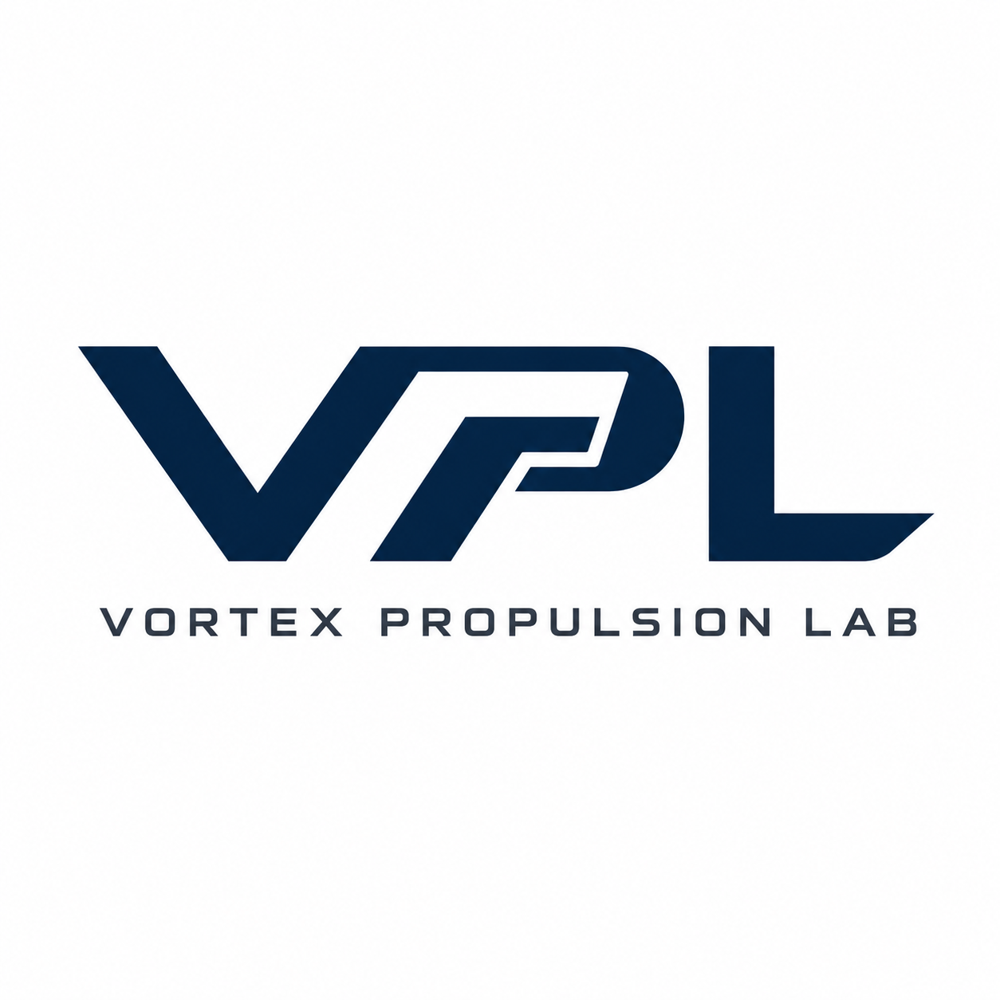
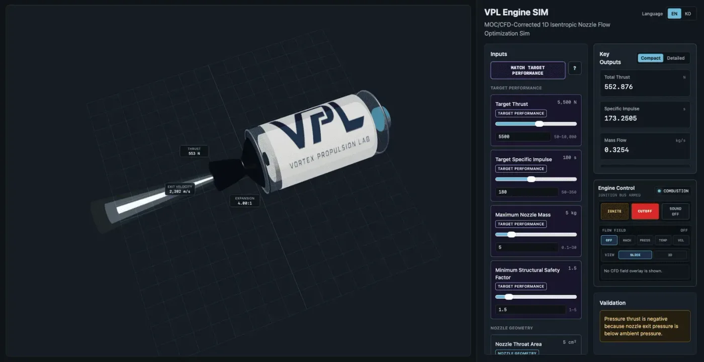
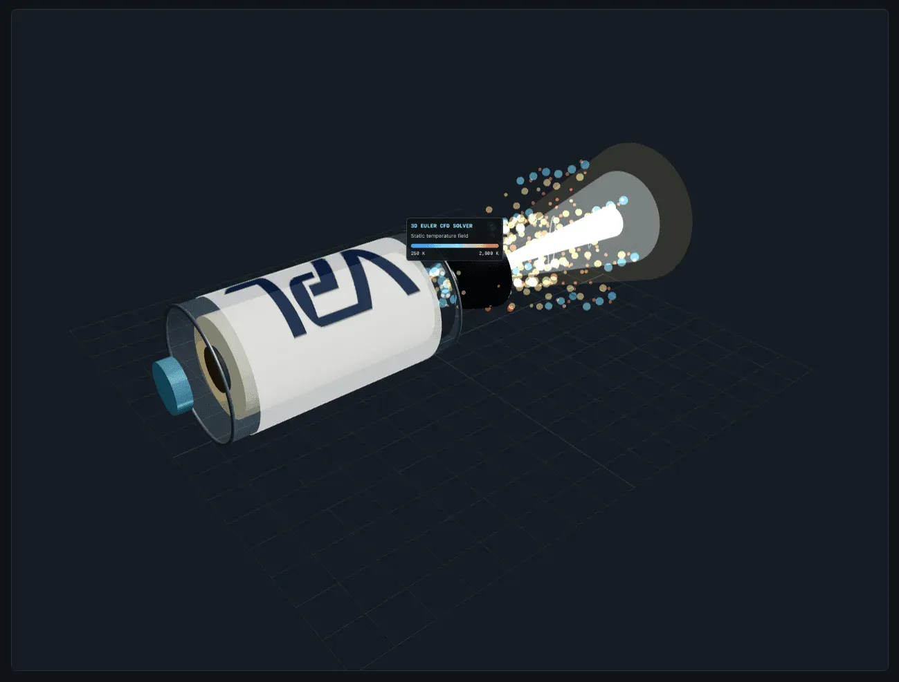

<div align="center">



# VPL Engine SIM

**MOC/CFD 보정을 적용한 1차원 등엔트로피 로켓 노즐 유동 최적화 시뮬레이터**


[**시뮬레이터 실행 →**](https://vpl.kro.kr/enginesim)



</div>

## 소개

웹에서 실시간으로 로켓 엔진 노즐 유동을 설계·해석하는 시뮬레이터입니다. 1차원 등엔트로피 유동 방정식에 특성곡선법(MOC)으로 노즐 형상을 설계하고, CFD 결과로 보정해 추력·비추력·마하수 분포 등을 계산합니다.

## 주요 기능

- **입력** — 목표 성능, 연소실 전압력·전온도, 노즐 형상, 외기 조건, 가스·연소 모델, 손실 보정, 제작 모델
- **목표 성능 맞추기** — 원하는 추력·비추력을 넣으면 출구 면적, 벨 길이, 형상 효율을 탐색해 노즐을 자동 설계
- **3D 유동장** — React Three Fiber로 노즐과 배기 플룸을 렌더링하고 마하수·압력·온도·속도 필드를 겹쳐 보기
- **엔진 제어** — 점화/차단과 연동되는 엔진 사운드
- **검증 패널** — 현재 입력이 1D 모델의 기본 가정을 만족하는지 실시간 확인
- **한국어 / English** 전환

<p align="center"></p>

## 구조

```
src/
├─ simulation/
│  ├─ rocketEquations.ts   등엔트로피 관계식 · 추력/비추력 계산
│  ├─ cfdSolver.ts         MOC/CFD 보정 · 유동장 생성
│  └─ validation.ts        입력 유효성 검사
├─ components/             입력·출력·검증 패널, 3D 씬(RocketScene), 엔진 사운드
├─ store/                  Zustand 전역 상태
└─ i18n/                   한/영 문구
```

## 실행

```bash
pnpm install
pnpm dev        # 개발 서버
pnpm build      # 타입 체크 + 프로덕션 빌드
pnpm check      # lint + format 검사 + build
```
